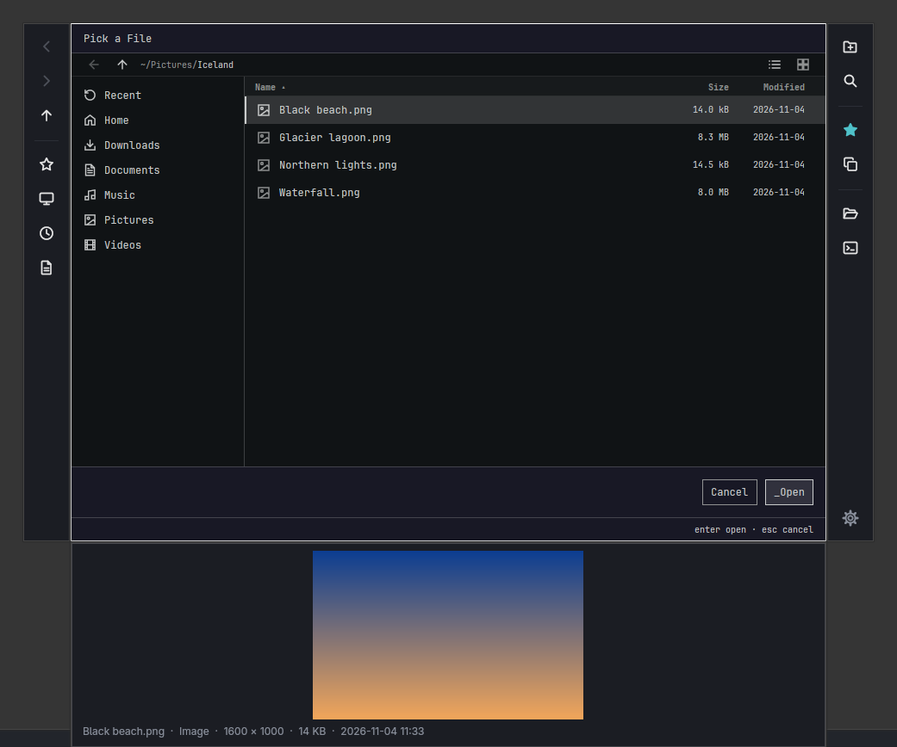
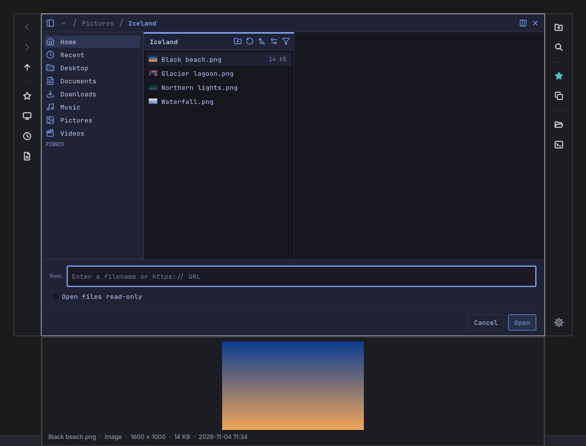
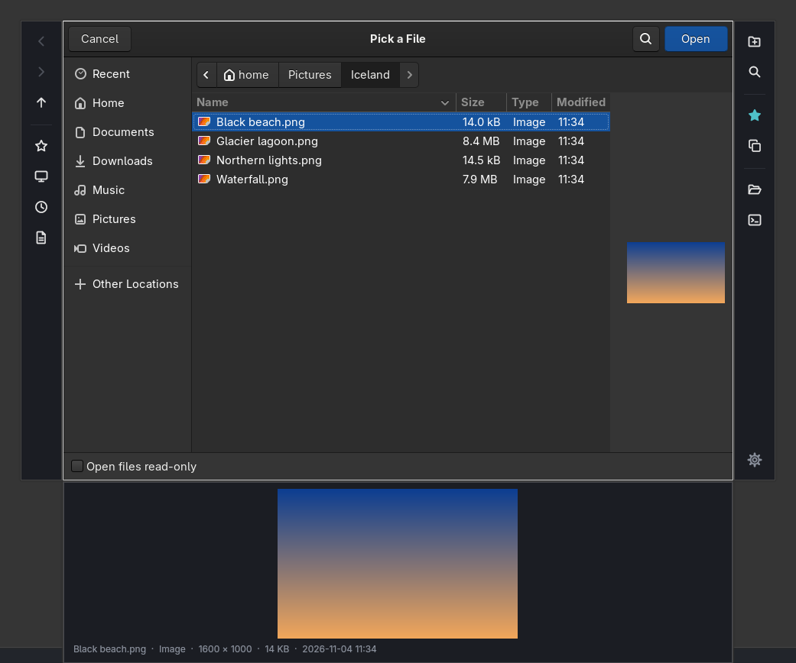
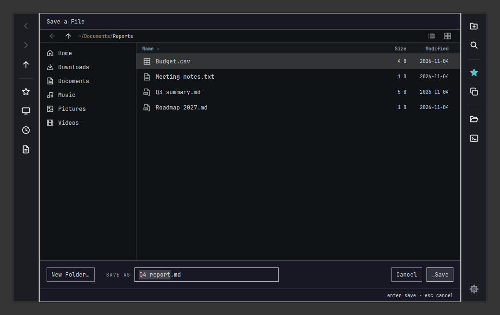
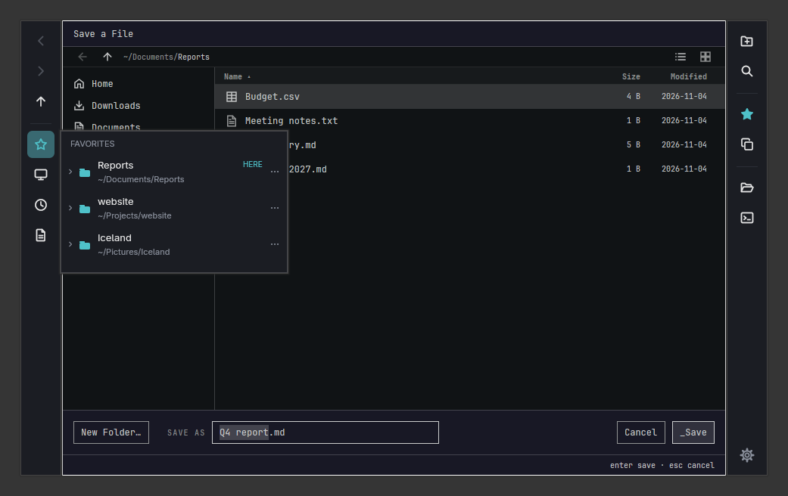
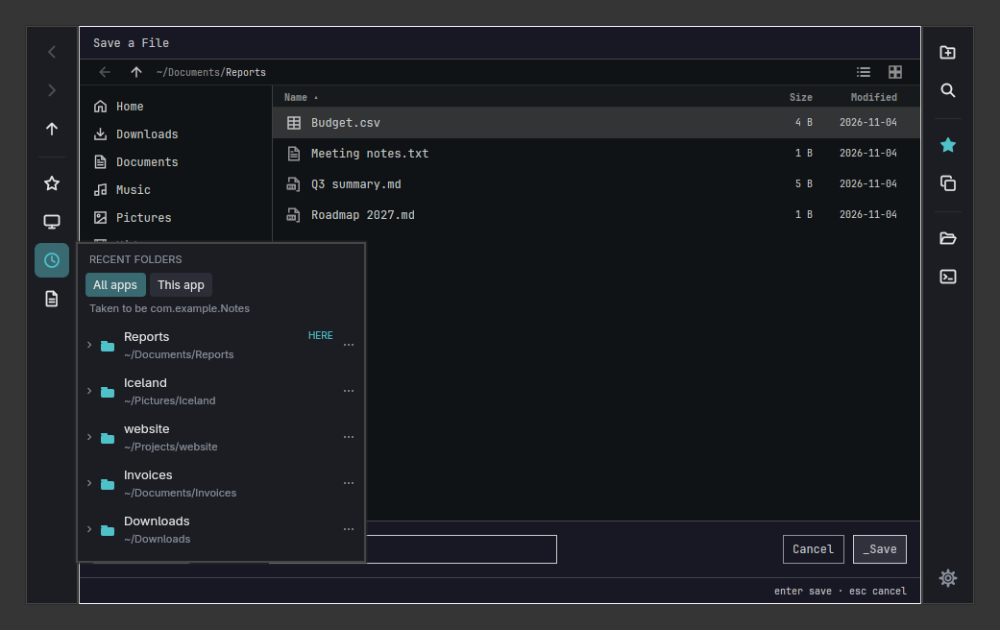
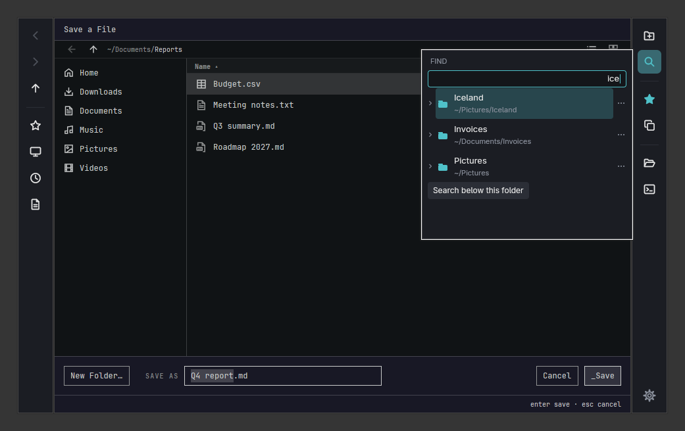
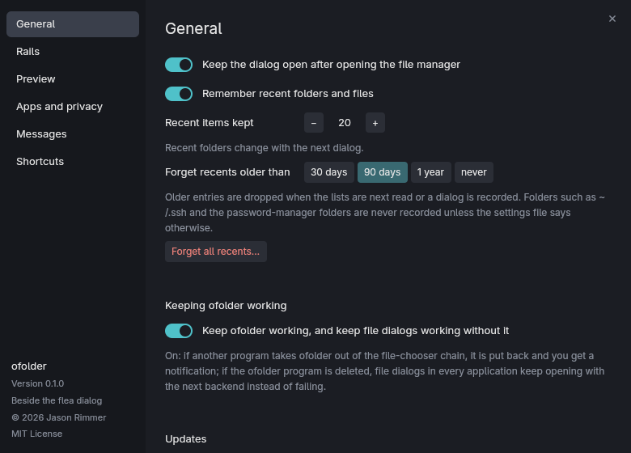
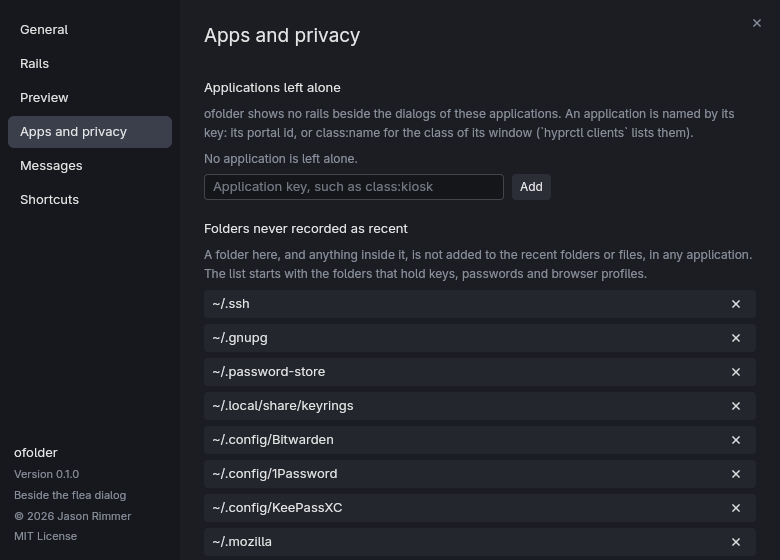

# ofolder

Favorites, recent folders, "new folder", find and a picture preview, docked beside the save and open
dialogs on [Omarchy](https://omarchy.org). It decorates Flea, the GTK portal dialog and Strata without
changing any of them.

<p align="center">
  
  
  
</p>
<p align="center"><sub>Flea 0.4.0, Strata and the GTK portal dialog. Two slim rails of icons sit beside the dialog; the preview sits under it.</sub></p>

## Install

```sh
curl -fsSL https://github.com/jrimmer/ofolder/releases/latest/download/install.sh | bash
```

It checks each download against its SHA-256, installs under `~/.local` (no root), and then switches
ofolder on. Read the script first if you like; `--no-setup` installs without switching it on, and
`--uninstall` removes it. [What switching on changes](#what-it-changes-and-how-to-undo-it) is below.

**You need** Omarchy (Hyprland on Wayland), a running `xdg-desktop-portal`, and one of Flea, the GTK portal
(`xdg-desktop-portal-gtk`) or Strata, plus `wtype` and `wl-clipboard`. `ffmpeg` is optional, for video
stills in the preview. Linux x86_64 only. Built and tested on Arch with Hyprland 0.57; other setups are untested.

## What you get

<p align="center">
  
</p>

- **Left rail:** back, forward and up; favorites, places and drives, recent folders, recent files.
- **Right rail:** new folder, find, add this folder to your favorites, copy its path, open it in your file
  manager or a terminal, and settings.
- **Favorites** you can rename, reorder and remove. **Recent folders and files**, all apps or just the one
  asking. **Find** ranks the folders ofolder knows as you type.
- **Preview** of a selected picture or video, under the dialog.
- **Shortcuts** for every rail command, set in the settings window.

<p align="center">
  
  
  
</p>

Everything is optional: the rails, their icons and their order are yours to change, in the settings window
or in `~/.config/ofolder/settings.toml` (every setting is listed in [packaging/README.md](packaging/README.md)).

<p align="center">
  
  
</p>

## What it changes, and how to undo it

Switching ofolder on changes how every save and open dialog on the machine is requested, so it is worth
knowing exactly what happens. It registers itself as a file-chooser backend that forwards to the real one:

- two small files, `~/.local/share/xdg-desktop-portal/portals/ofolder.portal` and a D-Bus service file for it;
- one line in your portal configuration (`~/.config/xdg-desktop-portal/hyprland-portals.conf`), which puts
  `ofolder` first in the file-chooser list and leaves every other backend after it; a backup of the file is kept;
- a small guard (`ofolder-guard.sh` and two systemd user units) that puts that line back if another program
  removes it, and keeps dialogs working if the ofolder program is ever deleted (turn it off in settings);
- a restart of the portal frontend so it notices.

If ofolder is missing or broken, your dialogs fall back to the next backend rather than failing.
To go back: `ofolder pause` makes every dialog pass through untouched (`ofolder resume` undoes that),
`ofolder repair --undo` restores the portal configuration, and `ofolder uninstall` removes the registration.

## If something looks wrong

- `ofolder doctor` says what is wrong and how to fix it; `ofolder repair` does the fixing.
- `ofolder doctor --report` prints the same with versions, and with your home folder, user and host name
  hidden, so you can paste it into an issue.
- ofolder reads interfaces that Flea and Strata do not document, so it records the versions it was tried
  with (Flea 0.4.0 and 0.3.12, xdg-desktop-portal-gtk 1.15, Strata 1.1.1). Any other version is said once, not
  blocked. If the rails misbehave after an update of one of them, please open an issue.

## Privacy

Everything stays on your machine, in files only you can read. ofolder remembers the folders and files you
confirm in dialogs, with the application that asked, for 90 days; folders that hold keys, passwords and
browser profiles are never recorded. `ofolder forget` empties the lists. Nothing is sent anywhere. Once a
week ofolder asks GitHub whether a newer release exists, and installs one only when you choose; switch that
off in settings. [packaging/README.md](packaging/README.md) lists what is kept and where.

## For developers

ofolder cannot embed another process's window, and none of these dialogs has a plugin API, so it reads and
drives each dialog from outside, through an adapter that says honestly what it can do.

| Where | What |
| --- | --- |
| `crates/core` | the adapter contract and the pure, tested logic (no UI, no D-Bus) |
| `crates/adapters` | the Flea, GTK and Strata adapters |
| `crates/portal` | the D-Bus file-chooser proxy |
| `crates/strip` | the gpui rails, menus and settings window |
| `crates/app` | the `ofolder` command, the guard and the updater |
| `e2e/` | the end-to-end suite |
| `spike/` | the experiment the design came from, with its evidence ([spike/README.md](spike/README.md)) |

```sh
bin/check     # fmt, clippy -D warnings, unit tests, architecture guard, guard and release tests (no display)
bin/e2e       # real Flea, GTK and Strata dialogs in a private nested Hyprland (needs a display; docs/e2e.md)
bin/install   # build and install the release build safely, keeping the previous one (--rollback)
bin/canary    # what changed in Flea, Strata, the portal or Hyprland since the last look
```

Build from source with `cargo build --release --locked` (a current stable Rust, edition 2024, plus a C
compiler; it is built and tested on Arch). `bin/install` does that and installs the result.

Start with [docs/adapters.md](docs/adapters.md), which records what was measured about each dialog and the
hazards, then [docs/requirements.md](docs/requirements.md) for what is built and how it was proven,
[docs/e2e.md](docs/e2e.md) for the test setup, [docs/updates.md](docs/updates.md) and
[docs/releasing.md](docs/releasing.md). [AGENTS.md](AGENTS.md) has the working rules: never type into a window
that has not been verified as the dialog, never guess a folder, tests never touch real folders, and `bin/check`
must pass (`bin/e2e` too, for anything that changes what a dialog shows or does). Issues and pull requests are welcome.

## License

MIT, see [LICENSE](LICENSE). ofolder is a separate program: it does not include or modify Flea, Strata or the
GTK portal.
